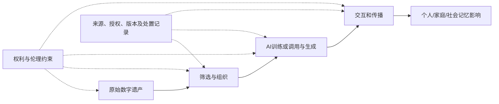
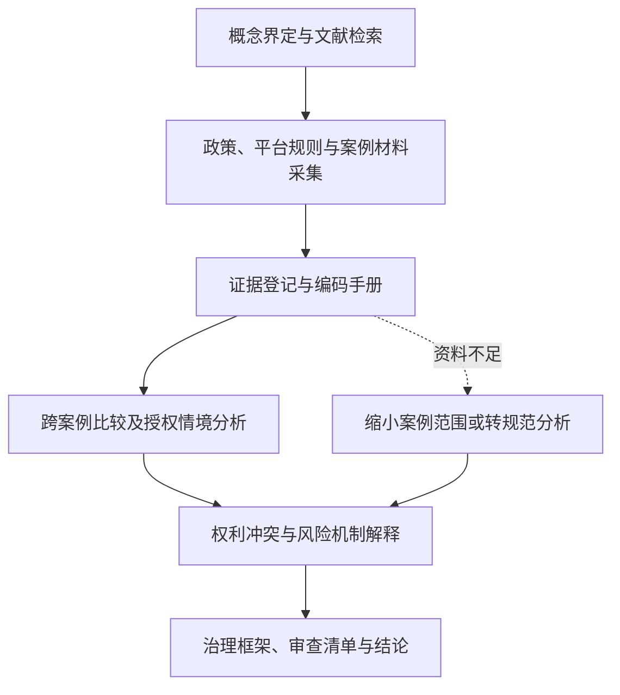

# 生成式人工智能背景下数字遗产的记忆治理与伦理风险研究

## 摘要

生成式人工智能正在改变个人数字遗产的存在形态与利用方式。社交媒体内容、聊天记录、照片、音视频及网络账号等数字资源，在个人去世后不仅可能作为遗产被保存、访问与处置，还可能被用于训练或驱动数字化身，生成逝者生前从未说过的话、从未发生过的互动及具有拟真效果的数字形象。这使数字遗产治理从传统的保存与继承问题，延伸至记忆真实性、信息自主性、人格利益、情感互动及公共传播等复杂议题。

本研究以**AI逝者模拟及其所依赖的数字遗产利用行为**为重点场景，从档案学与信息伦理学交叉视角出发，分析原始数字记录如何经选择、加工和算法生成转化为数字记忆，考察逝者生前意愿、近亲属利益、第三方权益和平台责任之间的冲突。研究采用文献研究、法律与平台规则文本分析、跨案例比较及情境分析，建立可复核的资料采集与编码规则，形成“**三类治理对象—六阶段治理流程—多主体责任配置**”的分析框架，并提出面向数字遗产AI利用的伦理审查清单与风险应对机制。

本报告为研究方案与选题论证文档，案例分析、指标编码与治理框架均属于拟开展的研究任务，尚不构成实证研究结论。

**关键词：** 数字遗产；数字记忆；生成式人工智能；AI逝者模拟；档案真实性；信息伦理；记忆治理

---

## 一、研究缘起与问题提出

### 1.1 现实背景：数字遗产从保存对象转为生成性资源

个人在网络空间中持续形成数字资料。个人去世后，数字资料所涉及的财产利益、私人信息、家庭记忆和社会关系并不会随着自然人生命终结而自动消失。不同于传统实物遗产，数字遗产通常由平台提供存储及访问条件，且一份数据可能同时涉及逝者、通信相对人、家庭成员、著作权人和平台等多个主体。

生成式人工智能使这一问题发生进一步变化：一方面，历史记录可以通过智能分类、检索与纪念叙事被重新组织；另一方面，文字生成、语音合成及形象模拟可将既有数据加工为持续交互的“数字逝者”。原始记录所能证明的真实经历，与算法根据这些记录推测生成的言行之间出现新的边界问题。数字遗产由此具有**记录性、可再加工性和生成性**相互交织的特征。

### 1.2 核心矛盾：记忆保存、人格尊重与技术利用的目标差异

| 关联主体或活动       | 主要诉求                | 可能产生的冲突                    |
| ------------- | ------------------- | -------------------------- |
| 逝者生前意愿及身后人格利益 | 按其意愿处理资料，避免形象被歪曲或滥用 | 生前未授权与身后模拟之间的冲突            |
| 家属与近亲属        | 保存记忆、表达哀思、维护合法权益    | 纪念需求与逝者意愿、其他亲属意见之间的冲突      |
| 数字平台与AI服务提供者  | 提供访问、保存、生成与交互服务     | 业务创新与数据使用边界、透明度、服务持续性之间的冲突 |
| 第三方信息主体       | 保护通信内容、肖像和个人隐私      | 逝者资料再利用与共同信息主体权益之间的冲突      |
| 档案与公共记忆活动     | 保存可信记录、维护来源与历史语境    | 记忆传播与删除请求、AI虚构内容之间的冲突      |

本研究以“**谁有权决定逝者如何在数字空间被保存、被再现和被遗忘**”作为总问题，进一步区分“资料能否被继承”“资料能否被访问”“资料能否被用于AI生成”“AI生成内容能否公开传播”四种不同层次的判断。

### 1.3 研究边界与区别

研究对象限定为与个人去世相关的数字资料及其AI生成利用，不讨论一般意义上的所有AI数字人，也不将数字遗产全部视为法律上的可继承财产。研究主要考察中国法律与平台制度下的权利配置，域外规则用于有限的比较分析。

与一般数字遗产继承研究相比，本研究将观察点延伸至**原始数据进入生成系统之后**；与一般AI伦理研究相比，本研究强调数字资料的档案来源、原始性、形成语境和记忆价值，并将可追溯性作为治理要求。

## 二、研究目标、研究问题与理论定位

### 2.1 研究目标

1. 明确数字遗产、数字记忆、AI逝者模拟与记忆治理的概念及其边界。
2. 梳理数字遗产在保存、访问、继承、删除、AI生成和传播过程中的差异化权利关系。
3. 识别生成式AI介入数字记忆建构的风险类型及其发生机制。
4. 通过公开案例、平台制度和法律政策文本比较，检验风险分析框架的解释力。
5. 形成具备操作步骤、证据要求和主体责任划分的数字遗产记忆治理方案。

### 2.2 核心研究问题

| 编号      | 研究问题                             | 重点分析对象                  | 对应研究任务      |
| ------- | -------------------------------- | ----------------------- | ----------- |
| RQ1（机制） | 生成式AI如何改变数字遗产的记录属性与数字记忆建构过程？     | 原始记录、整理后的记忆材料、AI生成内容    | 概念辨析与来源链分析  |
| RQ2（权利） | 数字遗产的访问、继承、删除与再生成利用之间具有何种权利边界？   | 逝者、近亲属、第三方、平台与服务商       | 法律及平台规则分析   |
| RQ3（风险） | AI逝者模拟在不同授权和使用场景下产生哪些伦理风险？       | 身份模拟、记忆真实性、隐私、情感关系和商业利用 | 跨案例比较与情境分析  |
| RQ4（治理） | 哪些治理措施可以使数字记忆保存与技术使用更可控、可追溯、可救济？ | 数据、模型/服务、生成结果和制度规则      | 治理框架与审查清单构建 |

### 2.3 核心概念

- **数字遗产：** 自然人去世后遗留的数字资源及与之相关的财产权益、人格利益、信息利益和记忆价值。数字遗产属于本研究的综合分析概念，其内部资源不当然全部构成《民法典》意义上的遗产。
- **数字记忆：** 借助数字媒介形成、组织、保存、检索和传播的个人、家庭或社会记忆，既包括原始记录，也包括在明确说明来源与加工过程的基础上形成的叙事作品。
- **记忆治理：** 对与记忆有关的数据选择、保存、解释、访问、生成、传播及退出等活动开展的规则制定、技术控制与权责协调。
- **AI逝者模拟：** 基于数字资料模拟逝者声音、形象、语言风格或交互模式的技术实践。其产出属于算法生成或技术组织的内容，不能直接等同于逝者本人的真实经历、言论或意愿。
- **被遗忘权：** 本研究在比较法脉络中讨论该概念，并与我国法律中的个人信息删除请求权分别界定，不将二者视为相同制度。

### 2.4 理论基础与分析关系

| 理论视角          | 核心概念                | 在本研究中的具体用途                     |
| ------------- | ------------------- | ------------------------------ |
| 档案真实性与来源原则    | 形成背景、来源、原始性、可追溯性    | 区分原始记录、编排内容与生成内容；核查资料来源和改动过程   |
| 档案价值鉴定与社会记忆研究 | 保存价值、选择、遗忘、记忆建构     | 分析何种资料应保存、限制访问或删除，以及算法如何改变记忆呈现 |
| 信息伦理学         | 自主性、知情同意、隐私、尊严、关怀伦理 | 分析逝者意愿、近亲属情感利益和第三方权利之间的冲突      |
| 技术治理与责任理论     | 透明度、问责、目的限定、救济      | 形成面向平台和AI服务商的流程控制与责任配置         |

研究的基本分析链条为：

本研究重点解释**原始记录与生成性记忆之间的转换过程**，并在每一环节识别权利边界与治理责任。

## 三、研究现状、制度基础与研究切入点

### 3.1 文献梳理的四条脉络

第一，数字遗产及身后数据管理研究关注网络账户、虚拟财产、继承与死后隐私。第二，档案与数字记忆研究关注真实记录的价值、来源、选择性保存和社会记忆建构。第三，AI数字身后服务研究关注“死亡聊天机器人”、数字化身及用户与模拟人格的交互关系。第四，生成式AI治理研究关注训练数据来源、生成内容标识、人格权益、风险评估和退出机制。

既有研究为本议题提供了分散的理论工具，但对**数字遗产从原始记录转为AI生成内容**这一转换链条的档案真实性要求、差异化授权规则和服务终止后的处置机制，仍有进一步综合分析的必要。相关研究不足的判断将通过正式文献检索加以检验，而不在选题阶段预设学术空白已经得到证明。

### 3.2 国内主要制度依据

| 制度依据                     | 研究相关内容                                                                       | 解释边界                                    |
| ------------------------ | ---------------------------------------------------------------------------- | --------------------------------------- |
| 《中华人民共和国民法典》第1122条、第127条 | 遗产范围与数据、网络虚拟财产保护                                                             | “数字遗产”不意味着所有账号和资料均可直接继承                 |
| 《中华人民共和国民法典》第994条        | 死者姓名、肖像、名誉、隐私等利益受到侵害时的救济                                                     | 亲属依法请求承担民事责任，不等于获得对逝者人格的无限处分权           |
| 《中华人民共和国个人信息保护法》第49条     | 近亲属为自身合法、正当利益依法行使查阅、复制、更正、删除等权利；死者生前另有安排的除外                                  | 该条不能直接推导出近亲属可任意用于商业训练和AI复现              |
| 《生成式人工智能服务管理暂行办法》        | 训练数据来源、合法权益保护、服务提供者义务                                                        | 需结合服务适用条件及具体行为判断                        |
| 《人工智能生成合成内容标识办法》         | AI生成合成内容标识要求；2025年9月1日起施行                                                    | 内容标识不等同于已经完成授权或免于侵权责任                   |
| 《人工智能拟人化互动服务管理暂行办法》      | 2026年7月15日起施行，规范向境内公众提供、模拟自然人人格特征并进行持续性情感互动的服务，涉及情感依赖防范、AI身份提示、退出、投诉与安全评估等要求 | 并非所有AI纪念视频均构成该办法所定义的持续性情感互动服务；须分别核对适用范围 |

在域外规则比较中，欧盟《通用数据保护条例》（GDPR）序言第27项说明其本身不适用于死者个人数据，并允许成员国制定相关规则。因此不能把GDPR第17条删除权直接作为所有逝者数字资料的统一处理依据。

### 3.3 本研究的具体切入点

本研究不将“是否支持AI复活”作为单一判断题，而采用**授权状态 × 利用目的 × 内容真实性**的情境化分析方式，分别讨论：

1. 逝者生前明确同意、明确反对或未作安排三类状态。
2. 私人纪念、公开传播与商业化利用三类目的。
3. 基于原始记录的检索重放、经编辑的纪念叙事、AI生成的新言行三类内容形态。

不同组合下的风险程度、权益主体和治理条件存在差异，需要在证据与具体规则基础上分别判断。

## 四、研究内容与分析框架

### 4.1 数字遗产的类型及其权利结构

研究将数字遗产初步区分为财产性资源、人格关联资料、私人通信资料与家庭/公共记忆材料，分别考察所有权或其他财产权、合同使用权限、著作权、个人信息相关权利及死者人格利益的保护，不把“平台账号”“账号内内容”和“账号访问资格”混为同一对象。

重点分析四组冲突：**继承与访问**、**保存与删除**、**亲属纪念需求与逝者生前意愿**、**数字遗产再利用与第三方隐私权益**。

### 4.2 AI介入数字记忆的七类风险

| 风险维度          | 主要表现                        | 观察与判断依据              |
| ------------- | --------------------------- | -------------------- |
| R1 授权与意愿风险    | 生前未授权、家属意见不一致、授权目的扩大        | 生前安排、授权条款、使用范围、争议记录  |
| R2 记忆真实性风险    | 模型编造逝者言行、生成内容被误认为原始记录       | 原始资料与输出对照、显著标识、来源说明  |
| R3 隐私与人格利益风险  | 通信数据泄露、肖像/声音滥用、人格形象歪曲       | 数据类型、第三方信息、公开范围、救济渠道 |
| R4 情感与关系风险    | 用户可能获得慰藉，也可能出现依赖或被情感操纵      | 产品定位、拟人化提示、时长提醒、退出设计 |
| R5 商业利用风险     | 纪念服务诱导付费、借逝者形象引流、二次训练       | 收费方式、营销内容、额外用途授权     |
| R6 公共记忆风险     | 虚构记忆传播、脱离历史语境、公众误认          | 传播场景、事实核验、纠错及撤回方式    |
| R7 服务存续与可迁移风险 | 平台终止、账户关闭、生成性服务消失导致记忆材料难以取回 | 导出方式、备份政策、终止通知、删除安排  |

以上类别为研究的初始分析维度，后续依据文献和案例材料修订；风险存在的可能性不等同于所有相关服务均已发生该风险。

### 4.3 三类治理对象与六阶段流程

**三类治理对象**分别为：

1. **原始数字遗产：** 生前形成的电子邮件、照片、音频、视频、文字资料等，重在合法来源、真实保存和访问控制。
2. **整理与叙事化数字记忆：** 经筛选、编目、剪辑、标注形成的数字纪念空间、数字故事等，重在保留原始依据与编辑痕迹。
3. **AI生成或交互式模拟内容：** 模型生成的逝者形象、声音、话语和互动记录，重在授权条件、明确标识、可追溯和风险救济。

| 治理阶段       | 主要风险控制点              | 应形成的记录或机制         |
| ---------- | -------------------- | ----------------- |
| ① 生前规划与授权  | 是否授权、授权对象与使用目的、禁用事项  | 数字遗产安排、授权记录       |
| ② 数据接收与核验  | 数据合法来源、身份核验、第三方信息    | 来源说明、数据清单、访问权限    |
| ③ 价值鉴定与整理  | 保存必要性、真实性、私密程度、历史语境  | 分类表、元数据、原件与编辑版关联  |
| ④ AI处理与生成  | 训练/调用目的、最小必要、生成内容可核性 | 操作记录、模型或服务说明、输出标识 |
| ⑤ 交互与传播    | 拟人化误认、情感风险、商业扩散      | 使用提示、访问限制、传播和纠错机制 |
| ⑥ 停止、删除与移交 | 停止服务、资料导出、依法删除、必要留痕  | 退出渠道、导出格式、处置日志    |

### 4.4 主要治理原则

治理机制围绕**生前意愿优先、合法目的与最小必要、原始记录和生成内容分离、可核验的来源链、身份与生成标识、分级访问、可退出和可救济**展开。对于明确禁止AI模拟的生前意愿、来源不明的私人资料和涉及第三方敏感权益的数据，应设置更严格的审查和限制。个人信息删除及停止处理仍须依照具体法律条件判断，不以“永久保存”或“无条件删除”作为统一规则。

## 五、研究方法、样本与资料来源

### 5.1 研究方法与整体路径

研究以**规范分析和跨案例比较为主，结构化编码为辅助**。数字遗产相关私密资料不易合法取得，直接制作真实逝者数字人亦存在伦理风险，因此本研究不以创建真实逝者模拟系统或获取家庭隐私资料作为实证条件。

采用的方法包括：

- **文献研究法：** 梳理档案真实性、社会记忆、数字遗产及AI数字身后服务研究；记录文献结论与研究局限。
- **规范分析法：** 对国内法律、行政规范及相关平台规则进行条款级比较，区分规范明确要求、平台自行规定与研究提出的伦理原则。
- **比较案例研究法：** 采用同一套编码维度分析具有不同权利与技术安排的案例，解释差异而非简单排名。
- **情境分析法：** 通过不涉及真实个人资料的假设情境，讨论生前授权、私人纪念、公开传播等因素如何改变判断。
- **结构化内容分析法：** 将公开政策、服务协议及新闻材料转换为可比的定性编码，保留原文出处和判定理由。

### 5.2 样本及来源

| 材料组          | 预定样本                                      | 数据获取方式              | 研究用途                 |
| ------------ | ----------------------------------------- | ------------------- | -------------------- |
| A 法律与政策材料    | 中国主要法律和AI治理规定约6—10项；域外制度1—2项              | 官方法律法规与监管机关网站       | 权利边界及适用范围            |
| B 平台制度材料     | Apple遗产联系人、Google闲置账号管理工具等2—3种            | 平台官方帮助中心、公开条款       | 生前安排、继承/访问、导出与删除机制比较 |
| C 事件案例材料     | 以2024年未经同意的已故公众人物AI复现争议为主要案例，另选可核验的公开事件1项 | 权威新闻、公开声明及可得的后续信息   | 识别授权冲突、生成传播和救济问题     |
| D AI数字身后服务材料 | 1—2种服务模式或已发表学术案例                          | 公开产品说明、研究论文、平台政策    | 比较“记录重放”与“生成性互动”的差异  |
| E 学术文献       | 根据主题相关性筛选核心论文                             | 中国知网、期刊网站、DOI及学术数据库 | 理论建构、研究现状及对照分析       |

**采样标准：** 与数字遗产处置或AI逝者模拟直接相关；存在可公开核验的一手规则或可靠二手证据；能够与至少另一案例形成有意义的比较。仅有营销宣传、未经证实的网络爆料或无法找到完整情境的素材不作为核心证据。

**材料分级：** A级为官方法规、官方平台政策及直接发布的公开声明；B级为有明确采访来源的可信新闻和同行评审论文；C级为未独立核实的产品宣传或社交媒体讨论。核心判断优先依赖A级与B级材料；C级材料仅用于发现问题并标明证据局限。

### 5.3 典型案例的比较设计

| 案例                                 | 类型        | 初步事实与分析对象                       | 对比目的                 |
| ---------------------------------- | --------- | ------------------------------- | -------------------- |
| C1 2024年已故明星AI“复现”争议               | 公开传播与争议事件 | 李玟、乔任梁等相关AI视频及家属公开反对、媒体调查材料     | 未经同意、商业化、人格利益、传播救济   |
| C2 Apple Legacy Contact            | 生前指定访问安排  | 用户可指定遗产联系人，符合条件后申请访问部分账户数据      | 事前授权、核验与有限数据访问       |
| C3 Google Inactive Account Manager | 账号闲置后数据安排 | 用户预先设置长期闲置时的通知与数据共享等选项          | 生前规划与平台自动化处置规则       |
| C4 AI数字身后服务的交互模式                   | 生成性记忆服务   | 根据已发表学术研究和可得平台说明分析记录式、检索式与生成式互动 | 记忆真实性、情感关系、服务退出与数据迁移 |

案例C2与C3不属于相同技术或相同触发条件，比较的是治理工具而非等同服务。案例C4如无法获得现行服务规则，则仅以公开的历史资料及同行评审研究分析具体技术模式，不推断其当前运营状态。

### 5.4 结构化分析指标与编码规则

比较编码采用六个一级维度、十二个观察项。该指标体系服务于**质性诊断和案例比较**，不用于宣称平台法律合规评级或对服务商进行精确优劣排名。

| 维度        | 观察项                          | 可观测材料              | 初始判断要点               |
| --------- | ---------------------------- | ------------------ | -------------------- |
| D1 授权与意愿  | D1-1 生前选择机制；D1-2 代理人或家属权限范围  | 授权页面、访问申请规则、争议声明   | 是否明确主体、范围、撤回或变更方式    |
| D2 数据权益   | D2-1 第三方信息保护；D2-2 目的限定和二次利用  | 规则条款、隐私政策、事件细节     | 是否区分访问与再生成、私人使用与商业使用 |
| D3 档案真实性  | D3-1 原件/生成内容区分；D3-2 来源与版本可追溯 | AI标识、来源说明、生成说明     | 是否容易将AI生成言行误认为真实记录   |
| D4 情感与传播  | D4-1 AI身份提示；D4-2 传播及情感风险控制   | 产品提示、内容发布机制、公开规则   | 是否降低用户误认与不适当依赖风险     |
| D5 退出与救济  | D5-1 停止与删除渠道；D5-2 争议处理       | 申诉、删除、下架、客服条款      | 是否有明确申请方式与处理反馈       |
| D6 持续性与责任 | D6-1 导出与迁移；D6-2 责任主体与终止安排    | 数据导出规则、服务协议、停止服务条款 | 平台退出时数据与记忆内容如何处置     |

每个观察项采用如下统一标记方式：

- **2＝规则或措施明确：** 公开材料能够确认有明确机制、适用条件及可识别的执行路径。
- **1＝原则性表述：** 公开材料提及该问题，但范围、程序或适用条件仍不清楚。
- **0＝明确缺失：** 可靠材料明确证明该机制不存在，或相关行为与所述机制冲突。
- **NA＝资料不足／不适用：** 无法从公开证据判断，或该事项不属于该案例业务范围。**未发现公开信息不直接编码为0。**

编码以“证据摘录—来源网址—采集日期—指标编号—判定理由”为最小记录单元。抽取至少20%的文本或案例观察项由两名成员独立编码，统计一致情况并对分歧进行复核；必要时修订定义、回溯重编。样本规模允许时报告Cohen's Kappa等一致性指标；不将自定分值理解为经验证的标准量表。

### 5.5 授权与使用目的的情境分析

情境分析构建一个三乘三的分析矩阵，研究相同技术在不同条件下的风险变化：

| 逝者生前状态／使用目的 | 私人纪念               | 公开传播                | 商业利用              |
| ----------- | ------------------ | ------------------- | ----------------- |
| 明确同意        | 核对授权内容、范围及第三方信息    | 核对是否授权公开及生成标识       | 核对是否特别涵盖商业用途和相关权利 |
| 未明确安排       | 判断家属是否具有相关合法依据及其限度 | 重点审查人格利益、第三方隐私及误导风险 | 严格审查合法性、正当性和商业风险  |
| 明确反对        | 重点考察尊重生前意愿与终止安排    | 原则上不以家属纪念需求替代逝者明确反对 | 强化禁用、投诉、下架和救济分析   |

该矩阵用于研究问题定位和规范讨论，**不直接代替具体法律事实判断**；情境均为抽象设定，不使用真实逝者私密资料进行模型生成。

### 5.6 资料处理与可复核性

研究建立材料采集日志，至少记录：来源名称、网页地址、发布日期、访问日期、证据类型、关键摘录、使用位置及事实核验状态。平台规则随时间变化，统一记录采集时间；涉及条款变更时保留版本差异。案例研究将**已核实事实、媒体观点、学术解释与本研究判断**分层标注，避免将争议表述直接写成司法认定。

## 六、研究实施步骤

1. **资料检索与研究边界确认。** 形成概念界定表、核心文献目录、法律政策清单，确定案例筛选标准。
2. **资料采集与证据登记。** 收集法律条文、平台公开规则、新闻案例和研究论文，建立带采集日期的证据台账。
3. **编码手册形成与试编码。** 对少量文本试编码，检验六个维度和十二个观察项是否可判定，修订标准。
4. **案例比较与情境分析。** 完成案例信息表、权利主体图、授权—目的矩阵和伦理风险对应表。
5. **治理框架建构。** 将案例中发现的冲突映射至三类治理对象与六阶段流程，明确各阶段的责任主体及控制手段。
6. **结果整理与报告形成。** 对照研究问题逐项作答，形成完整报告、可追溯的证据表、治理审查清单及课堂汇报成果。

## 七、可行性、研究风险与替代路径

| 研究风险         | 可能表现                      | 处理方式及替代路径                             |
| ------------ | ------------------------- | ------------------------------------- |
| 平台规则无法完整获取   | 部分服务关闭、政策页面下线、条款不公开       | 优先官方存量页面与可信学术研究；不足者只作模式分析，不判断现行合规情况   |
| 案例信息不完整或互相矛盾 | 新闻报道未覆盖事实全貌               | 多源交叉核验；保留争议和不确定性；不足以认定的事实不作为结论        |
| 授权和伦理障碍      | 涉及私人聊天、照片、声音及真实逝者信息       | 不采集未经授权的私人材料，不制作真实逝者数字人；转为公开文本与抽象情境研究 |
| 编码主观性较强      | 不同成员对“机制明确”理解不一致          | 设置操作化说明、示例和双人复核；分歧项重新讨论编码             |
| 概念与法律范围混淆    | 将数字遗产等同于遗产继承物，将被遗忘权等同于删除权 | 设置术语和条款核验表，明确每项规范的主体、条件及适用范围          |
| 案例异质性过强      | 账号处置平台与生成式服务技术差异明显        | 按“授权、真实性、退出”等共同治理问题比较，不直接合成综合排名       |
| 研究时间有限       | 无法开展访谈或大规模问卷              | 保留规范分析与三至四个公开案例；不以访谈和问卷作为必要前提         |

研究的可行性基础在于核心材料主要来自公开法律规范、平台制度和可核验报道，不依赖个人隐私数据、复杂模型训练或对真实逝者的身份模拟。公开资料能够支持制度设计与风险机制分析，但不足以直接证明具体平台内部算法如何运行，亦不能测量用户的实际心理影响。

## 八、预期研究结论的检验方向与创新点

### 8.1 待检验的分析命题

- **P1：** 相较于原始数字资料的保存与访问，生成式模拟增加了对使用目的、生成范围和输出真实性的独立治理需求。
- **P2：** 生前意愿明确程度、使用目的以及是否面向公众传播，构成判断数字遗产AI利用风险的重要条件。
- **P3：** 仅有“AI生成内容标识”不足以解决来源合法性、逝者意愿、第三方权益和服务退出等全部问题。
- **P4：** 将档案来源记录与生成服务的授权、版本、投诉和退出机制衔接，有助于建立可追溯、可纠正的数字记忆治理流程。

以上命题为研究假设或论证方向，需结合制度文本和案例证据讨论，不作为已经证实的事实。

### 8.2 研究特色与拟形成的创新

**第一，研究视角的交叉性。** 将档案学关注的原始性、真实性、来源和社会记忆，与信息伦理关注的意愿、隐私、尊严和责任相结合，讨论AI生成内容与原始档案之间的性质差异。

**第二，分析对象的层次性。** 将原始数字遗产、整理后的数字记忆和AI生成模拟内容分别纳入治理范围，避免以“数字遗产”单一概念覆盖不同利用活动。

**第三，研究过程的可操作性。** 采用公开材料分级、统一编码表、案例证据登记和情境矩阵，使规范性研究具备明确的比较规则与复核路径。

**第四，治理方案的完整性。** 将生前安排、数据接收、价值鉴定、AI生成、交互传播与停止退出连接为连续流程，尤其关注内容来源、身份误认、服务终止及数字记忆可迁移性。

## 九、研究局限与伦理边界

本研究主要使用公开文本与典型案例，研究结论适用于制度分析、风险识别和治理框架建构，不能据此推断公众整体态度、真实用户的长期哀伤反应，也不能对特定平台作未经充分证据支持的合规性结论。人工智能技术、平台服务和监管规则持续变化，相关材料以采集时间点为准。

研究不将AI模拟内容视为逝者的真实言论，不收集未经授权的私人通信和敏感数据，不制作或传播真实逝者的拟真生成影像，不以研究名义开展身份冒用。资料引用保留出处；对未经司法或行政认定的争议，采用“被质疑”“引发争议”等事实性描述，不预先认定具体主体违法。

---

##
